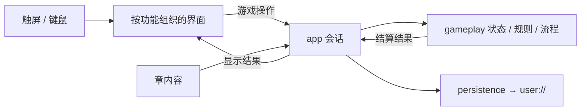

# 工程与文件系统组织设计

对应[正式开发前，确定工程与文件系统的组织设计](https://github.com/mxp-xc/emblem-rekindled/issues/13)。本文是实施的组织基线，目录按实际功能逐步建立。Godot4.7.2标准版、typed GDScript、Compatibility、首期Android竖屏与PC Web、自有随包资源和章间衔接政策保持。

## 原版界面与交互基线

每次实现新功能，先运行原版对照相关画面与操作，再实现并验证；对照应包含正常入口、信息排列、
面板位置、切页、确认和返回。已有原版截图可以复用，但必须核对与当前功能及状态相符。
界面尽量保留原版排版、布局、信息层级和像素游戏风格；允许使用更清晰、更好看的组件，
并适配触控尺寸与设备安全区，但不能使新增界面与地图、人物、对白产生明显风格割裂。
人物信息沿用顶部头像与身份资料、单页标题和左右切页、属性标签靠左数值靠右、随身物品列表及底部详情区。
界面与交互以 [开发文档](../development.md) 的当前契约为准；现代触控输入保持行动、确认和返回的业务含义。

## 1. 推荐组织方式

**一个Godot工程放在game/；共享业务逻辑独立，界面按功能聚合，章内容按章隔离。**

这是对既有工程职责草图的细化：不再将所有脚本和所有场景分别堆入scripts/、scenes/。地图操作的场景和专用脚本放在一起；战斗结算等可共享逻辑保留独立位置。目录随真实功能建立，不先创建第二章、终章或未来横屏的空目录。

```text
仓库根目录/
├── game/                         单一Godot工程；res://从这里开始
│   ├── project.godot
│   ├── export_presets.cfg         Android/Web预设，共享游戏逻辑
│   ├── app/                      启动场景、会话组装、场景切换
│   ├── gameplay/                 业务状态、操作校验/结算、回合/剧情流程
│   ├── features/                 各功能的场景、专用脚本及专用界面资源
│   │   ├── tactical_map/         战术地图、点选、拖动、范围和状态展示
│   │   ├── battle_animation/     独立战斗演出、镜头、受击/伤害反馈
│   │   ├── dialogue/             对白、教学与路线选择界面
│   │   └── menus/                标题、存读档和设置等界面
│   ├── ui/                       真正共用的控件、主题、字体等
│   ├── content/
│   │   ├── shared/               经确认跨功能/跨章共用的内容素材
│   │   └── chapter_1/
│   │       ├── chapter.json      章入口：所用关卡、数据、资源的明确引用
│   │       ├── generated/        工具拥有的、已转换为运行可用格式的结果
│   │       └── authored/         手工编写/核对的关卡、动作编排、替换素材
│   ├── persistence/              业务存档编码、校验与user://读写
│   ├── tests/                    业务验证入口、小型fixture和验收辅助场景
│   └── addons/                   选用第三方Godot插件后才建立
├── tools/                        可重复使用的资源整理/校验及必要构建辅助
├── reference/original-jars/       本地只读参考，保持Git忽略
├── docs/
│   ├── agents/                   现有Agent约定
│   ├── design/                   工程设计与可评审方案
│   └── research/                 需要长期保留的调研与验证结论
└── build/                        本地可再生成的构建产物，实施时配置Git忽略
```

树表示归属，不是要求第一批实现时创建整套骨架。首个最小工程只建立启动、地图、必要内容和验证入口；独立战斗等在对应阶段建立，但完整首关仍必须包含独立战斗演出。

## 2. 依赖与状态所有权

| 所属位置 | 拥有/负责 | 不应承担 |
| --- | --- | --- |
| gameplay/ | 权威业务状态；移动/战斗/道具、回合、事件和胜败推进；根据章内容处理已核对的差异 | 读取UI节点、播放动画、直接操作文件或读取原包 |
| app/ | 创建业务会话，注入章内容和随机源，连接界面与存档；接收输入意图，安排表现与保存时机 | 再实现一套命中/伤害公式或在界面外另存第二份角色数据 |
| features/与ui/ | 将触屏/键鼠转换为相同游戏操作；显示业务结果，回报演出完成 | 私自扣血、改耐久、掷随机结果或决定过关奖励 |
| content/ | 章内模板、开局布阵、地图、对白/事件、动作定义及素材引用 | 当前HP/背包耐久等运行中实例值，或者用户存档 |
| persistence/ | 从业务状态产生存档数据，验证并恢复；安全写入和错误报告 | 重新结算战斗、补发奖励、保存整棵场景树 |

依赖方向为：app连接gameplay、content加载入口、persistence和features；features通过信号或传入的最小调用接口提交操作并接收显示资料，不依赖会话具体类或向上查找某个固定父节点；gameplay仅依赖自己的类型与传入的内容/随机源，不反向依赖上述界面和文件读写。存档转换可依赖业务状态类型；业务规则不调用存档实现。内容加载/校验入口在app侧将章文件转换为业务定义，不在每个场景重复解析JSON。

下面表示运行时交互；具体对象由app组装，不要求增加统一事件总线：



主要调用路径：输入意图→业务校验/结算并更新状态→一次行动结果→地图/独立战斗演出→显式完成回报→开放下一操作/处理待存档。一次结算只执行一次；重放画面或调整动画不能再掷命中/暴击/掉落。演出、剧情和敌方行动中的输入限制由会话/流程统一约束。

不默认建立全局事件总线、通用插件系统或所有东西均可访问的GameManager。优先由启动/会话持有实例并显式连接；确有跨场景生命周期需求时，再判断是否使用Autoload。

### 长期进度、战局与表现

- 长期进度保存正式队伍、培养、持有物品/仓库、资金、章/路线/结局记录。战局保存当前章/关卡、布阵/坐标、回合与行动状态、关卡事件及临时部队等。
- 同一正式角色/持有物品只有一份可写实例数据；正式队伍和战场部署通过实例身份引用，不能各复制一份成长或耐久后分别更新。具体GDScript类与字段随首关实际实现细化，不预造完整三章schema。
- 物品模板保留默认值；持有物品保存自己的耐久等当前值。临时参战角色与正式队伍显式区分；章间衔接不能直接复制整个战场单位集合。
- 镜头、选中格、面板、动画进度等属于表现；不据此重建权威战局。首期正式存档恢复到已确认的行动间隙，不存正在播放的动画节点。
- 正式存档不固定后续随机序列；保存过的结果不变，读档后重新发生的随机事件允许变化。开发验证注入可控随机源，不将测试seed强加到正式存档。

## 3. 章内容、生成结果与人工内容

1. 地图、人物/物品模板、对白与事件等引用带章上下文。跨章同号或同名不默认相同；实例身份与模板身份分开。将来接入新章时补章入口、对应内容和已验证的转换，不改写初章数据来迎合后章。
2. 三章统一的算法留在gameplay/；经核对的数值/参数差异放对应章的数据，确实需要不同流程时在业务逻辑中增加小范围、明确归属的章规则。没有证据前不写任意规则DSL、继承框架或大量if-chapter分支。
3. generated/只放运行可直接使用的PNG/Ogg、结构化数据、Godot原生资源等；它是随项目管理的可用资源快照，不是Godot导入缓存。正常运行/导出使用已准备好的结果，不要求每次构建重新读取原JAR；需要更新来源内容时再执行整理工具。生成器只写自己拥有的目录，不能覆盖authored/或章入口。来源hash、提取参数与校验信息由工具记录，不将本地绝对路径写进运行配置。本轮不上传原始或转换素材；后续源码和资源的提交仍遵守用户授权。
4. authored/保存人工核对的关卡/动作编排以及以后替换的高清素材。章入口或相应数据文件明确引用所采用的定义；同一身份只有一个生效定义。不做隐式目录优先级扫描或任意深度合并；重复/缺失ID、悬空引用应明确报错。
5. 逻辑格坐标、素材锚点/逻辑尺寸、显示缩放分开。图片替换通过素材引用和尺寸/锚点配置完成，不让规则根据原PNG宽高推导移动、射程或人物身份。高清人物/物品不在本期制作。
6. 帧裁剪、锚点/偏移与动作编排归素材/演出定义；独立战斗读取已结算结果来播放，不在帧脚本中实现战斗公式。旧动画格式仅在开发期参考/转换，运行时不引入原JAR/PAK或旧字节码解释器。
7. 跨章转换属于长期进度的业务操作；读取合法章末记录后，按已验证映射建立下一章初始状态。失败保留上份有效记录，重复恢复不重复转换或发奖励；具体两次映射由已有接章验证票解决，首关不实现它们。

## 4. 存档、配置与平台归属

- 随包内容位于res://；用户存档和设置位于user://。存档记录自身版本和章/关卡身份，先校验，再恢复；不静默把损坏档当新开局。
- 存档写入先完成临时文件，再替换正式记录；失败保留上份有效进度。Android和Web持久化分别验证，不能仅凭本机文件系统成功声称跨平台安全。具体槽位交互延续已有首关验收范围，后续按真实流程实现。
- Android/Web共享同一业务与场景实现，各维护导出预设及必要平台差异。键鼠与触屏在输入侧归一；安全区、音频恢复、Web音频手势解锁/存储持久化在确有差异的调用处处理，不按平台复制整套游戏。
- 目录/文件使用snake_case，场景节点/类遵循Godot约定。场景与专用脚本相邻；资源路径由项目引用维护，不把临时目录作为正式资源源头。Godot生成的UID应随对应源码/资源管理，不自行重写UID来规避引用问题。
- export_presets.cfg可版本管理；编辑器缓存game/.godot/、导出凭据、机器SDK路径和临时产物不进入共享源码。未来如第三方工具需要配置，单独记录固定版本和本机入口，不影响游戏运行。

## 5. 开发/验证入口与导出产物

开发与验证入口如下，实际命令见[开发说明](../development.md)：

| 入口 | 位置/方式 | 目的 |
| --- | --- | --- |
| 编辑器/导入 | Godot CLI指定game/；先导入再检查 | 消除首次导入/全局类型缓存差异，确认资源可加载 |
| 业务验证 | game/tests/内headless入口 | 通过同一业务接口覆盖规则、状态推进、随机分支及存档契约；失败返回非零 |
| 场景/表现验证 | 小型验收场景或正式关卡入口 | 核对指针定位、拖动、文字、安全区、像素缩放、动画/音频及输入锁定 |
| Android/Web导出 | 同一export_presets.cfg，两套预设 | 产物写build/android/、build/web/；匹配4.7.2模板另行对齐安装 |
| Web预览 | 仅提供导出文件的本地HTTP | 不在本地服务中实现游戏逻辑或原素材解析 |
| 资源整理 | tools/ | 可重复转换/校验，只作用于明确拥有的输出路径 |

首期沿用Godot CLI，不为上述入口自建构建框架。需要辅助命令时优先少量直接入口，不为单行调用增加多层包装。Python工具按仓库约定用uv，JS工具用bun；第三方依赖先对齐。

game/tests/必须留在Godot可加载范围，但从正式导出排除；不能放.gdignore后又期望运行时preload它。动态读取的JSON等非资源文件需要明确导出包含规则；不能只导出场景依赖后假定它们全部随包。

开发插件如采用，按插件路径明确排除，并核对runtime autoload/探针是否仍被引用；不是只删除服务进程就认为正式包没有开发依赖。构建验收同时检查导出文件和独立启动，确保没有reference/、tools/、docs/、build/、tests/、MCP服务/探针等依赖。

需要长期保留的设计、调研、验收说明与必要证据存放在docs/对应主题目录，并在相关issue引用。可重复生成的APK/Web产物放在build/，不将它们当作版本管理的文档交付。仅供agent当次查看的过程文件使用系统临时目录，不设项目临时目录作为交接入口。

## 6. 实施边界与后续入口

整体组织原则为：**共享业务独立、表现按功能聚合、章内容按章隔离**。目录树和职责是设计约束；具体小文件、类拆分和资源名称在实施时按真实复杂度决定，不以创建完整目录树作为设计或开发完成的标准。

AI工具选型参考[本游戏AI工具适配调研](../research/godot-ai-tools.md)，不成为目录设计的硬前置。用户尚未采纳任何第三方skill/MCP；本稿不预装、不预造插件兼容层。

首个实施阶段见[Godot最小工程实施计划](first-godot-milestone.md)，实际推进与验收证据维护在实施issue和地图。游戏使用单屏战场；常用按钮贴边、状态与操作按点选显示，低频设置收在菜单。不自行commit、push或变更分支。

## 依据

- [既有首关工程基线](https://github.com/mxp-xc/emblem-rekindled/issues/5#issuecomment-6521033357)、[共享与章内职责边界](https://github.com/mxp-xc/emblem-rekindled/issues/2#issuecomment-6519138219)、[章间进度政策](https://github.com/mxp-xc/emblem-rekindled/issues/4#issuecomment-6521381086)。旧scripts/scenes/assets职责草图在本稿按功能聚合细化，产品契约不因此改变。
- [Godot项目组织建议](https://docs.godotengine.org/en/4.7/tutorials/best_practices/project_organization.html)：场景相关资源就近组织、文件命名、addons和.gdignore限制。
- [Godot场景组织建议](https://docs.godotengine.org/en/4.7/tutorials/best_practices/scene_organization.html)：明确启动入口，由持有者组织依赖，降低场景间隐式耦合。
- [Godot导出配置](https://docs.godotengine.org/en/4.7/tutorials/export/exporting_projects.html)：资源模式、非资源文件包含规则、export_presets.cfg与凭据的归属。
- [Godot文件系统](https://docs.godotengine.org/en/4.7/tutorials/scripting/filesystem.html)：res://与user://分工；[版本控制建议](https://docs.godotengine.org/en/4.7/tutorials/best_practices/version_control_systems.html)：缓存与项目文件分开管理。
